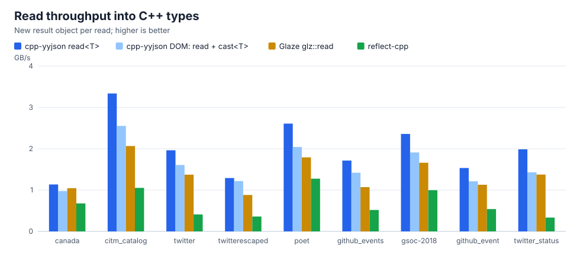
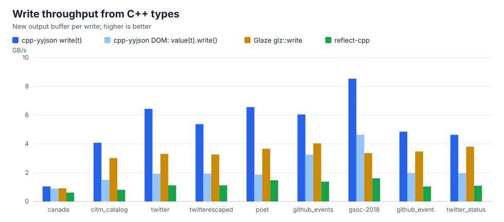
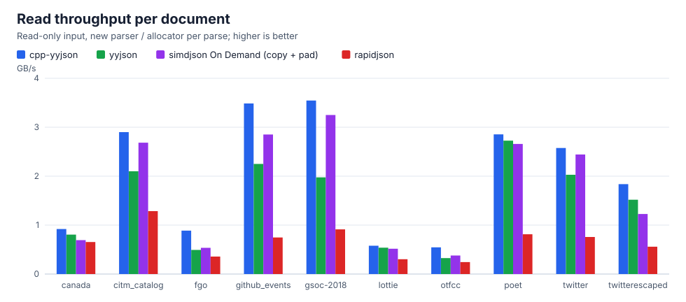
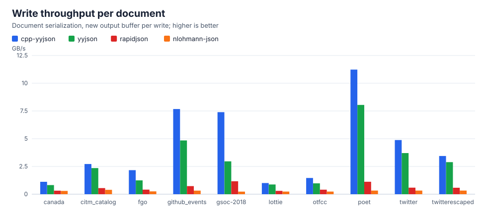

# cpp-yyjson

Fast JSON for C++20: read and write your own types directly, or work with JSON of any shape through a DOM that feels like the standard library.

cpp-yyjson is a JSON library for C++20 with two APIs that share one set of conversions:

*   The **data binding API** reads JSON text into your own types and writes them back, with one call each way. Plain structs need no macro, and the text goes straight into them, with no JSON tree in between.
*   The **DOM API** reads JSON of any shape into a document. Its arrays and objects are C++20 ranges, and each value converts to a C++ type.

Both APIs are fast. The chart shows how fast each library reads nine JSON documents into the same C++ types, with both APIs of cpp-yyjson. The DOM API is faster than yyjson 0.12.0 itself on every document of the benchmarks: up to 1.8 times for reading and 2.5 times for writing. [Performance](#performance) gives the writes and the other libraries.



cpp-yyjson is built on [yyjson](https://github.com/ibireme/yyjson) and comes as two headers, `cpp_yyjson.hpp` and `field_reflection.hpp`. It ships a faster [fork of yyjson](#bundled-backend) with the same API and output, which CMake builds as a static library.

[](https://github.com/yosh-matsuda/cpp-yyjson/actions/workflows/tests.yml)

**Your types, one call each way.** This program reads a JSON document into plain structs, changes them with ordinary C++ and writes them back:

```cpp
#include "cpp_yyjson.hpp"
#include <iostream>
#include <map>

struct Release
{
    std::string version;
    std::optional<std::string> notes;  // left out of the JSON when it has no value
};

enum class Status
{
    active,
    archived
};

struct Project
{
    std::string name;
    Status status;
    std::vector<Release> releases;
    std::map<std::string, int> downloads;
};

int main()
{
    auto project = yyjson::read<Project>(R"({
        "name": "cpp-yyjson",
        "status": "active",
        "releases": [{"version": "2.0.0", "notes": "new API"}],
        "downloads": {"linux": 120}
    })");

    project.releases.push_back({.version = "2.1.0", .notes = std::nullopt});
    project.downloads["macos"] = 40;

    std::cout << yyjson::write(project) << '\n';
    // -> {"name":"cpp-yyjson","status":"active","releases":[{"version":"2.0.0","notes":"new API"},{"version":"2.1.0"}],"downloads":{"linux":120,"macos":40}}
}
```

The structs need no macro, base class or registration, because compile-time reflection matches each member with the JSON member of the same name. The enumeration is read and written by its name, the map becomes a JSON object, and the empty `notes` is left out.

**Errors that point at the value.** When the JSON does not fit the type, `yyjson::bad_cast` names the value by its JSON Pointer and its position in the text:

```cpp
yyjson::read<Project>(R"({"name":"cpp-yyjson","status":"retired"})");
// bad_cast: JSON string is not the name of an enumerator of Status at /status (line 1, column 31, pos 30)
yyjson::read<Project>(R"({"name":"cpp-yyjson","downloads":{"linux":"120"}})");
// bad_cast: int is not constructible from JSON string at /downloads/linux (line 1, column 43, pos 42)
```

**JSON of any shape, with standard C++.** The DOM API reads any JSON into a document. Its objects work with range-for, structured bindings, `std::views` and `std::format`, and `cast<T>` converts a value to a C++ type:

```cpp
auto doc = yyjson::read(R"({"USD":1.17,"JPY":172.4,"GBP":0.87})");
auto rates = *doc.as_object();  // as_object() returns std::nullopt for JSON that is not an object

for (const auto& [currency, rate] : rates) std::cout << std::format("{}: {}\n", currency, rate);
// -> USD: 1.17
//    JPY: 172.4
//    GBP: 0.87

auto above_one = rates | std::views::filter([](const auto& kv) { return *kv.second.as_real() > 1.0; }) | std::views::keys;
// a view of the keys "USD" and "JPY"

auto table = rates.cast<std::map<std::string, double>>();  // the whole object as a C++ map
```

## Highlights

*   **One set of conversions for both APIs.** `cast<T>` converts a DOM value to a C++ type, and `value(t)` converts a C++ object to a DOM value. A struct can hold [DOM values as fields](docs/conversions.md#json-values-as-fields) for the parts of a document whose shape is not fixed.
*   **Fast with both APIs.** The data binding API reads the text straight into your types, and the DOM API runs on a faster fork of yyjson. [Performance](#performance) compares both APIs with other JSON libraries.
*   **Most standard types, nested in any combination.** `read<T>` and `write` convert structs, containers, maps, `std::optional`, `std::variant`, smart pointers, enumerations and recursive types. `read_into` and `merge_into` read into an existing object, and `merge_into` applies the JSON as a [JSON Merge Patch](https://www.rfc-editor.org/rfc/rfc7396).
*   **Tolerant reading.** Unknown keys are ignored, and missing keys keep their defaults. Values that do not fit throw `yyjson::bad_cast`, with the [path and the position](docs/validation.md#conversion-errors) of the value.
*   **A DOM that builds JSON from C++ values.** `yyjson::object` and `yyjson::array` are built from containers and initializer lists. `emplace` adds a member to an object, and `emplace_back` adds an element to an array.

## Installation

Fetch the repository with CMake and link `cpp_yyjson::cpp_yyjson`, which compiles the [bundled backend](#bundled-backend) and adds the include directory:

```cmake
include(FetchContent)
FetchContent_Declare(cpp_yyjson
    GIT_REPOSITORY https://github.com/yosh-matsuda/cpp-yyjson.git
    GIT_TAG v2.1.0
    GIT_SHALLOW TRUE
    GIT_SUBMODULES "")
FetchContent_MakeAvailable(cpp_yyjson)

target_link_libraries(my_app PRIVATE cpp_yyjson::cpp_yyjson)
cpp_yyjson_enable_lto(my_app)  # optional: optimize the backend together with my_app
```

`GIT_SHALLOW` leaves out the history, and `GIT_SUBMODULES ""` leaves out the only submodule, which holds benchmark data, so that the download is about 5 MB instead of 400 MB. The project builds no tests when it is not the top-level project.

A clone works the same way with `add_subdirectory`, and an installed cpp-yyjson with `find_package`:

```cmake
add_subdirectory(<PATH_TO_CLONE_DIR>/cpp-yyjson ${CMAKE_CURRENT_BINARY_DIR}/cpp-yyjson)
# or
find_package(cpp_yyjson CONFIG REQUIRED)
```

Without CMake, copy `cpp_yyjson.hpp`, `field_reflection.hpp` and `yyjson.h` from `include`, and compile `src/yyjson.c` as C together with your program; MSVC also needs `/Zc:preprocessor`. cpp-yyjson has no vcpkg or Conan package. To use the upstream yyjson instead of the bundled backend, install it, for example with `vcpkg install yyjson`, and configure with `-DCPPYYJSON_USE_BUNDLED_YYJSON=OFF`; without CMake, copy only the two cpp-yyjson headers.

### Requirements

*   C++20 compiler with range support
    *   GCC 13-16
    *   LLVM 17-22
    *   AppleClang 16 (Xcode 16.2), 17 (Xcode 26.3), and 21 (Xcode 26.6)
    *   MSVC `cl` and `clang-cl` on `windows-2022` and `windows-2025`
*   GCC 16 with `-std=c++26 -freflection` is also supported. C++26 reflection also converts structs with base classes or more than 100 fields, and accepts member annotations such as `[[=yyjson::rename("@context")]]` ([details](docs/conversions.md#reflection)).
*   [yyjson](https://github.com/ibireme/yyjson) 0.6.0 or later, only when it is used instead of the [bundled backend](#bundled-backend). With yyjson older than 0.12.0, `read<T>` and `write` build an intermediate document and are slower.

### CMake options

| Option | Effect |
| --- | --- |
| `CPPYYJSON_ENABLE_AVX2=ON` | Compiles the backend with AVX2 in addition to SSE2; the binary then requires an AVX2-capable CPU. |
| `CPPYYJSON_USE_BUNDLED_YYJSON=OFF` | Uses an external yyjson package instead of the bundled backend. |
| `CPPYYJSON_READER_DEPTH_LIMIT`, `CPPYYJSON_WRITER_DEPTH_LIMIT`, `CPPYYJSON_DISABLE_FILE` | Set the yyjson [compile-time options](https://ibireme.github.io/yyjson/doc/doxygen/html/building-and-testing.html#compile-time-options) `YYJSON_READER_DEPTH_LIMIT`, `YYJSON_WRITER_DEPTH_LIMIT` and `YYJSON_DISABLE_FILE`. |
| `CPPYYJSON_DISABLE_HUGE_PAGES=ON` | Turns off the huge pages of the bundled backend. |
| `CPPYYJSON_RECURSION_DEPTH_LIMIT` | Limits how deeply values of [recursive types](docs/conversions.md#recursive-types) are read. |

[Build configuration](docs/reference.md#build-configuration) covers link-time optimization, the options with an external yyjson and building this repository.

## How do I...

| Task | Use |
| --- | --- |
| [Read JSON into a struct and write it back](docs/quick-start.md#read-json-into-a-struct-and-write-it-back) | `read<T>(json)`, `write(t)` |
| [Read a JSON file](docs/guide.md#read-a-json-file) | read the file into a string, then `read<T>` |
| [Use a JSON key other than the member name](docs/guide.md#use-a-json-key-other-than-the-member-name) | `yyjson::rename` in `yyjson::annotations<T>` |
| [Find the value that failed](docs/guide.md#find-the-value-that-failed) | `bad_cast::path()`, `bad_cast::position()` |
| [Choose a variant alternative by a `"type"` member](docs/guide.md#choose-a-variant-alternative-by-a-type-member) | a `std::variant` with `yyjson::internal_tag` |
| [Convert a type of another library, such as a date](docs/guide.md#convert-dates-and-times) | a translator, `yyjson::caster<T>` |
| [Look up values in JSON of unknown shape](docs/guide.md#look-up-values-in-json-of-unknown-shape) | `read(json)` and the DOM |
| [Apply a partial update](docs/guide.md#apply-a-partial-update) | `merge_into(json, t)` |

The [Guide](docs/guide.md) covers many more tasks, and lists [what cpp-yyjson does not do](docs/guide.md#what-cpp-yyjson-does-not-do), with workarounds.

## Data binding API

The data binding API converts between JSON text and C++ types without building a document in between. With the types of the example at the top:

```cpp
using namespace yyjson;

auto project = read<Project>(R"({"name":"cpp-yyjson","status":"active","releases":[],"downloads":{}})");

auto json = write(project);                       // a yyjson::json_string: a std::string_view that owns its buffer
auto pretty = write(project, WriteFlag::Pretty);  // indented
auto relaxed = read<Project>(R"({"name":"x","status":"active","releases":[],"downloads":{},})", ReadFlag::AllowTrailingCommas);

read_into(R"({"name":"y","status":"active","releases":[],"downloads":{"linux":1}})", project);  // reuses the memory of project
merge_into(R"({"status":"archived"})", project);  // a JSON Merge Patch: changes only "status"
```

Invalid JSON throws `yyjson::read_error`. JSON that does not fit the type throws `yyjson::bad_cast`, with the path and the position of the value that failed ([details](docs/validation.md#conversion-errors)). The [Quick start](docs/quick-start.md) walks through both APIs, and the Guide shows how to shape [keys and fields](docs/guide.md#keys-and-fields), convert [other types](docs/guide.md#types), [diagnose errors](docs/guide.md#diagnosing-errors) and do [repeated work](docs/guide.md#repeated-work) fast.

## DOM API

The DOM API reads JSON of any shape into a *document*, an immutable tree that you query and iterate. The arrays, objects, numbers and strings in it are *values*. `yyjson::value`, `yyjson::array` and `yyjson::object` are *mutable values*, which you build from C++ values and modify:

```cpp
using namespace yyjson;

auto doc = read(R"({"name":"cpp-yyjson","stars":42,"topics":["json","cpp"]})");
auto obj = *doc.as_object();  // as_*() returns std::optional
for (const auto& [key, value] : obj) std::cout << key << " = " << value.write() << '\n';

auto topics = cast<std::vector<std::string>>(obj["topics"]);  // any value converts to a C++ type
topics.push_back("c++20");

auto repo = object{{"name", "cpp-yyjson"}, {"stars", 43}, {"topics", topics}};
repo.emplace("archived", false);
std::cout << repo.write() << '\n';
// -> {"name":"cpp-yyjson","stars":43,"topics":["json","cpp","c++20"],"archived":false}
```

A mutable value refers to the strings it is built from instead of copying them, so `repo` must not outlive `topics`; see [Lifetimes](docs/reference.md#lifetimes). For a whole object, prefer `read<T>` and `write`: they skip the document and are faster than `read(json).cast<T>()` and `value(t).write()`. The Guide covers [JSON of any shape](docs/guide.md#json-of-any-shape), and the [API reference](docs/reference.md#dom-classes) describes the classes.

## Conversions and customization

Both APIs share the same conversions. They cover the following types, nested in any combination:

*   numbers, `bool` and strings
*   [enumerations](docs/conversions.md#enumerations), by name or by integer
*   standard containers and maps
*   `std::optional` and smart pointers
*   `std::variant`, also [tagged](docs/conversions.md#tagged-variants) by a member, and tuples
*   aggregate structs, by [compile-time reflection](docs/conversions.md#reflection) or [`VISITABLE_STRUCT`](docs/conversions.md#visitable_struct)
*   [DOM values as fields](docs/conversions.md#json-values-as-fields)
*   any type with a [user-defined caster](docs/conversions.md#user-defined-casters)

[Annotations](docs/conversions.md#annotations) in `yyjson::annotations<T>`, or C++26 annotations on the members, rename keys, skip fields, rename enumerators and tag variants. A caster converts a type of your own, most simply as a *translator* to a type that the library already handles. The concepts `yyjson::readable<T>` and `yyjson::writable<T>` check a type at compile time. [Converting C++ types](docs/conversions.md) gives the rules.

## Performance

The numbers below were measured on an Intel Core i9-12900K with GCC 15.2, with cpp-yyjson using the bundled backend with AVX2 and link-time optimization. [docs/benchmark](docs/benchmark/README.md) gives the full environment and the library versions.

### Data binding API vs. Glaze and reflect-cpp

cpp-yyjson, [Glaze](https://github.com/stephenberry/glaze) and [reflect-cpp](https://github.com/getml/reflect-cpp) read seven documents of [yyjson_benchmark](https://github.com/ibireme/yyjson_benchmark#json-datasets) and two short messages into the same C++ structs and write them back. The table gives how many times faster cpp-yyjson is:

| cpp-yyjson | vs. Glaze | vs. reflect-cpp |
| --- | --- | --- |
| Read into a new object: `read<T>` | 1.09 - 1.61x | 1.68 - 5.95x |
| Read into a reused object: `merge_into` | 1.05 - 1.64x | - |
| Write into a new string: `write(t)` | 1.15 - 2.53x | 1.70 - 5.73x |
| Write into a reused string: `write(t, out)` | 1.05 - 1.53x | - |




For a reused object, cpp-yyjson's `merge_into` is compared with Glaze, because both keep the members that the next document omits. `read_into` resets them instead. reflect-cpp has no interface that reuses the object or the string. The charts also show the DOM API reading and casting (`read(json).cast<T>()`) and building and writing (`value(t).write()`). See [docs/benchmark](docs/benchmark/README.md#data-binding-api) for the environment and every document.

### DOM API vs. other libraries

cpp-yyjson is compared with [yyjson](https://github.com/ibireme/yyjson), [simdjson](https://github.com/simdjson/simdjson), [rapidjson](https://github.com/Tencent/rapidjson/) and [nlohmann-json](https://github.com/nlohmann/json) on the ten documents of [yyjson_benchmark](https://github.com/ibireme/yyjson_benchmark#json-datasets), from 0.1 MB to 66 MB. Reading parses a document and visits every element; writing turns a parsed document back into JSON text. The table gives how many times faster cpp-yyjson is. Each cell is the range of the speed-ups over the documents:

|       | vs. yyjson 0.12.0 | vs. simdjson | vs. rapidjson | vs. nlohmann-json |
| ----- | ----------------- | ------------ | ------------- | ----------------- |
| Read  | 1.0 - 1.8x | 1.0 - 1.6x   | 1.4 - 4.6x    | 8.7 - 24x         |
| Write | 1.2 - 2.5x | 2.5 - 6.0x   | 3.2 - 10x     | 3.8 - 34x         |





simdjson reads by its fastest method, On Demand, and writes its DOM with `simdjson::to_string`. See [docs/benchmark](docs/benchmark/README.md#dom-api) for the environment, every document and how to reproduce the numbers.

## Bundled backend

cpp-yyjson ships with its own copy of yyjson, a [fork](https://github.com/yosh-matsuda/yyjson/tree/simd) of the upstream 0.13.0 release that only changes how fast it runs. The API, the accepted input and the output are those of yyjson, and the fork passes the upstream test suite, so nothing in your code depends on which of the two is used.

The table below shows what gets faster. It was measured in the [benchmark](#dom-api-vs-other-libraries) with AVX2 enabled, against the prebuilt yyjson 0.12.0 from vcpkg. The fork is based on 0.13.0, so the speed-ups include the upstream changes between 0.12.0 and 0.13.0.

| Workload | Why it is faster | Speed-up |
| --- | --- | --- |
| Reading JSON with many or long strings | strings are scanned 16 or 32 bytes at a time with SSE2/AVX2 | 1.5 - 1.8x |
| Reading pretty-printed (indented) JSON | the indentation of each line is skipped in one step | 1.3 - 1.4x |
| Reading numbers | digits are read four at a time | 1.1x |
| Writing JSON with many or long strings | strings that need no escape are copied in blocks with SSE2/AVX2 | 1.4 - 2.5x |
| Writing floating-point numbers | `double` and `float` are converted to text with C ports of [xjb64 and xjb32](https://github.com/xjb714/xjb), faster shortest round-trip algorithms, which give the same text as yyjson | 1.2 - 1.4x |
| Reading or writing documents of tens of megabytes, on Linux | large blocks are backed by transparent huge pages, which saves most of the page faults | 1.4 - 1.8x |

Documents that are none of these are read and written at about the upstream speed. The SSE2/AVX2 paths are for x86-64, with AVX2 on request (see [CMake options](#cmake-options)), and the huge pages need Linux with glibc and apply only to blocks of 32 MiB or more.

To use the upstream yyjson instead, configure with `-DCPPYYJSON_USE_BUNDLED_YYJSON=OFF`.

## Documentation

*   Getting started: [Quick start](docs/quick-start.md)
*   How-to guides: [Guide](docs/guide.md), [FAQ](docs/faq.md)
*   Concepts: [Converting C++ types](docs/conversions.md), [Validation and errors](docs/validation.md)
*   Reference: [API reference](docs/reference.md)
*   Performance: [Performance best practices](docs/performance.md), [Benchmarks](docs/benchmark/README.md)

The [documentation index](docs/README.md) says what each document answers.

## License

cpp-yyjson is released under the [MIT License](LICENSE). The bundled backend in `src/yyjson.c` and `include/yyjson.h` is derived from [yyjson](https://github.com/ibireme/yyjson), which is also released under the MIT License. Its floating-point-to-string conversion is a C port of [xjb](https://github.com/xjb714/xjb), released under the [Apache License 2.0](LICENSE-xjb).

## Author

Yoshiki Matsuda ([@yosh-matsuda](https://github.com/yosh-matsuda))
