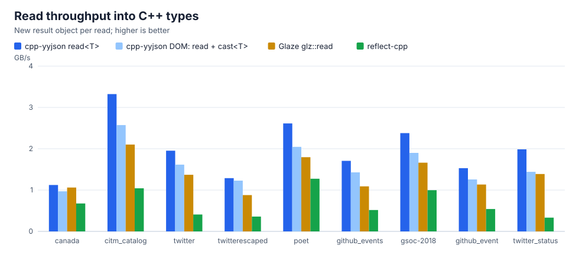
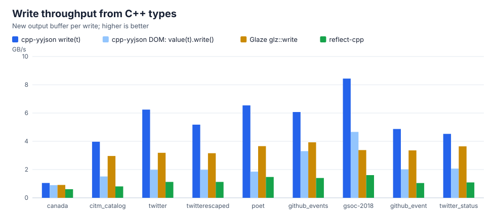
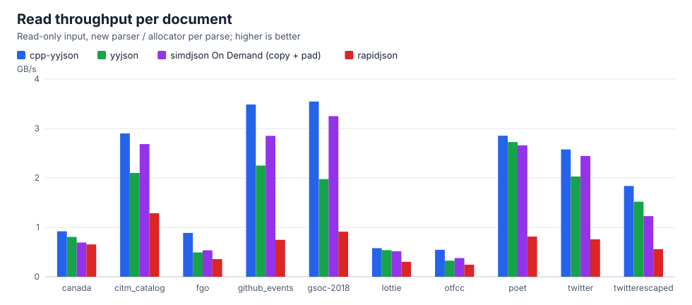
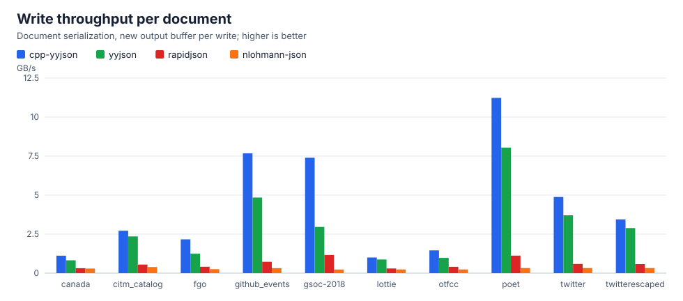

# cpp-yyjson

Fast JSON for C++20: read and write your types directly, or work with a flexible DOM.

[](https://github.com/yosh-matsuda/cpp-yyjson/actions/workflows/tests.yml)

```cpp
#include "cpp_yyjson.hpp"

struct User
{
    std::string name;
    int age;
    std::vector<std::string> roles;
    std::optional<std::string> email;
};

auto user = yyjson::read<User>(R"({"name":"Alice","age":30,"roles":["admin"]})");
user.age += 1;
auto json = yyjson::write(user);
// -> {"name":"Alice","age":31,"roles":["admin"]}
```

No macro, no registration and no intermediate JSON tree: the field names come from compile-time reflection, and the JSON text is read straight into `User` and written straight from it. When the shape of the JSON is not known in advance, the same library reads it into a DOM that you can query and iterate with C++20 ranges, and builds new documents from values, containers and initializer lists.

cpp-yyjson is a header-only C++ interface to [yyjson](https://github.com/ibireme/yyjson), and ships with a [fork of it](#bundled-backend) tuned for speed as its default backend.

## Highlights

*   **Performance.** Reading and writing are among the fastest of the major C++ JSON libraries, with both APIs, on the real-world documents measured in [Performance](#performance). `read_into` and `write(t, out)` reuse the memory of the previous call in a loop, and the bundled backend adds SIMD paths for strings and other optimizations to yyjson.
*   **Two APIs, chosen per task.** The data binding API reads JSON text into C++ types and writes them back without building a document in between. The DOM API reads JSON of any shape into a document that can be queried, iterated and modified, and builds new documents. [Which API to use](#which-api-to-use) lists the common cases.
*   **One call each way, no boilerplate.** `read<T>(json)` and `write(t)` convert aggregates by their field names through compile-time reflection, with no macro or registration. STL containers, `std::optional`, `std::variant` with or without a tag member, `std::shared_ptr`, tuples, enumerations by name and recursive types are supported, and `VISITABLE_STRUCT`, `yyjson::field_rename` and user-defined casters cover other types and JSON keys.
*   **Tolerant of changing JSON.** Keys that the type does not have are ignored, missing keys keep the default value of the field, and an empty `std::optional` is left out when writing. `merge_into` applies a [JSON Merge Patch](https://www.rfc-editor.org/rfc/rfc7386) to an existing object, which updates a configuration with only the keys that changed.
*   **A DOM that feels like the standard library.** Arrays and objects are C++20 ranges, objects yield key-value pairs for structured bindings, accessors return `std::optional`, values are formattable with `std::format`, and documents are built from containers, views and initializer lists.

## Contents

1.  [Data binding API](#data-binding-api)
    1.  [Reading and writing C++ types](#reading-and-writing-c-types)
    2.  [Reading into an existing object](#reading-into-an-existing-object)
2.  [DOM API](#dom-api)
    1.  [Reading JSON](#reading-json)
    2.  [Building JSON](#building-json)
    3.  [Between the DOM and C++ types](#between-the-dom-and-c-types)
3.  [Supported types and casters](#supported-types-and-casters)
4.  [Which API to use](#which-api-to-use)
5.  [Performance](#performance)
6.  [Bundled backend](#bundled-backend)
7.  [Requirements](#requirements)
8.  [Installation](#installation)
9.  [Reference](docs/reference.md)
10. [License](#license)

## Data binding API

The data binding API converts between JSON text and C++ types without building a JSON document in between.

### Reading and writing C++ types

`yyjson::read<T>` reads a JSON string into any type that cpp-yyjson can convert, and `yyjson::write` writes one back:

```cpp
#include "cpp_yyjson.hpp"

using namespace yyjson;

struct Release
{
    std::string version;
    std::optional<std::string> notes;            // left out of the JSON when empty
    std::map<std::string, int> downloads;
};

struct Project
{
    std::string name;
    std::vector<std::string> tags;
    std::vector<Release> releases;
};

auto project = read<Project>(R"({
    "name": "cpp-yyjson",
    "tags": ["json", "c++20"],
    "releases": [{"version": "1.2.0", "downloads": {"linux": 10, "windows": 5}}]
})");
// -> Project{"cpp-yyjson", {"json", "c++20"}, {Release{"1.2.0", std::nullopt, {{"linux", 10}, {"windows", 5}}}}}

auto json = write(project);
// -> {"name":"cpp-yyjson","tags":["json","c++20"],"releases":[{"version":"1.2.0","downloads":{"linux":10,"windows":5}}]}

auto pretty = write(project, WriteFlag::Pretty);

// Reuse the capacity of the output string in a loop
auto out = std::string();
write(project, out);
```

A JSON string that is not valid JSON throws `yyjson::read_error`, and one that does not fit the type, such as a string where `int` is expected, throws `yyjson::bad_cast`. Keys that the type does not have are ignored, and a field whose key is missing keeps its default value.

The JSON text is read and written without a document by the bundled backend, or by an external yyjson 0.12.0 or later. With an older yyjson, the same functions go through a document and give the same results.

### Reading into an existing object

`yyjson::read_into` gives an existing object the value that `read<T>` would return, and reuses the memory of its strings and containers, so reading documents of the same shape over and over allocates almost nothing after the first one. `yyjson::merge_into` instead applies the JSON string as a [JSON Merge Patch](https://www.rfc-editor.org/rfc/rfc7386): what the JSON does not mention keeps its value, and `null` resets a field or erases a key.

```cpp
struct Config
{
    std::string name;
    int retries = 3;
    std::map<std::string, int> limits;
};

auto config = Config();
for (const auto& message : messages)  // e.g. a std::vector<std::string>
{
    read_into(message, config);       // the same result as config = read<Config>(message)
    apply(config);
}

// Change two settings and keep the others
merge_into(R"({"retries": 5, "limits": {"memory": null}})", config);
```

See the reference for [`read<T>`](docs/reference.md#reading-a-json-string-into-a-c-object-directly), [`read_into` and `merge_into`](docs/reference.md#reading-a-json-string-into-an-existing-c-object) and [`write`](docs/reference.md#writing-a-c-object-to-a-json-string-directly).

## DOM API

The DOM API reads JSON into a document that you can query, iterate and convert piece by piece, and builds documents from C++ values. Use it when the shape of the JSON is not known in advance, or when you build JSON that has no C++ type.

### Reading JSON

`yyjson::read` returns an *immutable* JSON value, whose arrays and objects are C++20 ranges:

```cpp
#include "cpp_yyjson.hpp"

using namespace yyjson;

auto val = read(R"({
    "id": 1,
    "name": "example",
    "array": [0, 1, 2, 3, 4],
    "currency": {"USD": 129.66, "EUR": 140.35, "GBP": 158.72}
})");

// as_xxx methods return std::optional
auto obj = *val.as_object();
auto id = *obj["id"].as_int();
auto name = *obj["name"].as_string();

// Arrays and objects are ranges; an object yields key-value pairs
auto list = *obj["array"].as_array();
for (const auto& v : list) std::cout << v.write() << std::endl;
auto currency = *obj["currency"].as_object();
for (const auto& [k, v] : currency) std::cout << k << ": " << v.write() << std::endl;

// inspect() dispatches on the type of a value in one std::visit call
std::visit(overloaded{[](std::string_view s) { std::cout << s << std::endl; }, [](const auto&) {}},
           obj["name"].inspect());

// write() stringifies any value
std::cout << obj.write() << std::endl;
// -> {"id":1,"name":"example","array":[0,1,2,3,4],"currency":{"USD":129.66,"EUR":140.35,"GBP":158.72}}
```

### Building JSON

`yyjson::value`, `yyjson::array` and `yyjson::object` are *mutable* and are built from C++ values, ranges and initializer lists:

```cpp
using namespace yyjson;

auto arr = array();
arr.emplace_back(1);
arr.emplace_back("string");

auto obj = object();
obj.emplace("USD", 129.66);
obj.emplace("date", "Wed Feb 1 2023");

// From ranges, including views
auto squares = array(std::vector{1, 2, 3} | std::views::transform([](int x) { return x * x; }));
// -> [1,4,9]
auto prices = object(std::map<std::string, double>{{"USD", 129.66}, {"EUR", 140.35}});
// -> {"EUR":140.35,"USD":129.66}

// From initializer lists
auto doc = object{{"id", 1}, {"array", {0, 1, 2}}, {"currency", {{"USD", 129.66}}}, {"success", true}};
std::cout << doc.write() << std::endl;
// -> {"id":1,"array":[0,1,2],"currency":{"USD":129.66},"success":true}
```

### Between the DOM and C++ types

`yyjson::cast<T>` converts a JSON value, or any part of a document, to a C++ type, and the constructors of `value`, `array` and `object` convert a C++ object to JSON. They use the same conversions and casters as the data binding API:

```cpp
auto doc = read(R"({"project": {"name": "cpp-yyjson", "tags": [], "releases": []}, "extra": [1, 2]})");
auto project = cast<Project>((*doc.as_object())["project"]);
auto numbers = cast<std::vector<int>>((*doc.as_object())["extra"]);

auto obj = object(project);
obj.emplace("stars", 1000);
```

See the reference for the [immutable](docs/reference.md#immutable-json-classes) and [mutable](docs/reference.md#mutable-json-classes) classes and their [allocators](docs/reference.md#allocator-classes).

## Supported types and casters

Both APIs convert the following types, nested in any combination:

*   `bool`, integer and floating-point types, `std::nullptr_t`, and strings such as `std::string`;
*   [enumerations](docs/reference.md#enumerations), as the names of their enumerators, also as the keys of maps;
*   ranges such as `std::vector`, `std::array` and `std::set`, and maps and ranges of key-value pairs such as `std::map` and `std::unordered_map`;
*   `std::optional`, `std::shared_ptr`, `std::variant` and tuple-like types ([C++23 tuple-like](https://wg21.link/P2165R4)), and a `std::variant` [tagged](docs/reference.md#tagged-variants) by a member that names its alternative;
*   structs and classes converted by [compile-time reflection](docs/reference.md#automatic-casting-with-compile-time-reflection), or registered with the [`VISITABLE_STRUCT`](docs/reference.md#registration-of-field-names-of-structclass) macro, including C array fields, empty structs and [recursive types](docs/reference.md#recursive-types);
*   `yyjson::value`, `yyjson::object` and `yyjson::array`, which keep a part of the JSON as a value of the DOM API ([details](docs/reference.md#json-values-as-fields));
*   any type with a user-defined caster.

A JSON key that is not a valid C++ identifier is mapped to a field with `yyjson::field_rename`:

```cpp
struct Thing
{
    std::string context;
    std::string name;
};

template <>
inline constexpr auto yyjson::field_rename<Thing> = {yyjson::rename("context", "@context")};

auto thing = yyjson::read<Thing>(R"({"@context":"https://schema.org","name":"x"})");
```

With C++26, the same can be written in the struct as `[[=yyjson::rename("@context")]] std::string context;` ([details](docs/reference.md#c26-annotations)).

A user-defined caster converts a type of your own. The simplest form is a *translator*, which converts the type to and from another type that cpp-yyjson already handles:

```cpp
struct Color
{
    int r, g, b;
};

template <>
struct yyjson::caster<Color>
{
    // "#rrggbb"
    static Color from_json(std::string_view hex)
    {
        if (hex.size() != 7 || hex[0] != '#') throw yyjson::bad_cast("Color is not constructible from JSON");
        const auto byte = [&](std::size_t i) { return std::stoi(std::string(hex.substr(i, 2)), nullptr, 16); };
        return {byte(1), byte(3), byte(5)};
    }
    template <typename... Ts>
    static std::string to_json(const Color& c, Ts...)
    {
        return std::format("#{:02x}{:02x}{:02x}", c.r, c.g, c.b);
    }
};

auto colors = yyjson::read<std::vector<Color>>(R"(["#ff8000","#000000"])");
auto json = yyjson::write(colors);
// -> ["#ff8000","#000000"]
```

The forms of a caster are listed below in the order to choose them. All but the last work with both APIs without a document. The last one takes a JSON value of the DOM API, and the data binding API reads each such value into a temporary document. See [User-defined casters](docs/reference.md#user-defined-casters) for all of them.

| Purpose | Form |
| --- | --- |
| Tell the alternatives of a `std::variant` by a member that names them | no caster: [`variant_tag`](docs/reference.md#tagged-variants) |
| Convert to and from another type, such as a struct to a string | [translator](docs/reference.md#translator) `from_json(U)` and `to_json(const X&)` that returns a value |
| Read into a field that cannot be copied or moved | [in-place](docs/reference.md#reading-into-an-existing-field) `from_json(X&, U)` |
| Write members that depend on the value | `to_json` with an [emitter](docs/reference.md#writing-members-with-an-emitter) |
| Leave a field out of the JSON object | [`should_omit`](docs/reference.md#omitting-a-field-with-no-value) |
| Decide how to read a value from its content, such as an object of keys known only at run time | [`from_json(yyjson::json_view)`](docs/reference.md#reading-a-json-value-in-a-caster) |
| The same, with the DOM API | [`from_json(const Json&)`](docs/reference.md#reading-a-json-value-in-a-caster) |

## Which API to use

| Task | Recommended |
| --- | --- |
| Convert JSON text to a C++ type | `read<T>(json)` |
| Read many documents of the same shape | `read_into(json, t)` |
| Apply a partial update | `merge_into(json, t)` |
| Convert a C++ object to JSON text | `write(t)`, or `write(t, out)` to reuse the string |
| Read JSON of unknown or varying shape | `read(json)` and the DOM |
| Keep a member of unknown shape in a C++ type | a field of type `yyjson::value` |
| Build or modify JSON that has no C++ type | `value`, `array` and `object` |
| Convert part of a document | `cast<T>(value)` on that part |

`read(json).cast<T>()` and `value(t).write()` remain supported and give the same results as `read<T>(json)` and `write(t)`, which are faster because they skip the document.

## Performance

### Data binding API vs. Glaze

cpp-yyjson and [Glaze](https://github.com/stephenberry/glaze) read seven documents of [yyjson_benchmark](https://github.com/ibireme/yyjson_benchmark#json-datasets), from 0.07 MB to 3.5 MB, into the same C++ structs, which have a member for every key, and write them back. The table gives how many times faster cpp-yyjson is:

|  | Fresh result object / output | Reused result object / output |
| --- | --- | --- |
| Read: `read<T>` vs. `glz::read` | 1.1 - 1.6x | 1.0 - 1.7x (`merge_into`) |
| Write: `write(t)` vs. `glz::write` | 1.2 - 2.3x | 1.0 - 1.5x (`write(t, out)`) |





The charts also show the DOM API reading a document and casting it (`read(json).cast<T>()`) and building a document and writing it (`value(t).write()`), which the data binding API replaces. A reused Glaze object keeps the members that the next document does not have, as `merge_into` does, so the reused read compares the two. The environment and the charts of each document are in [docs/benchmark](docs/benchmark/README.md#data-binding-api).

### DOM API vs. other libraries

cpp-yyjson is compared with [yyjson](https://github.com/ibireme/yyjson), [simdjson](https://github.com/simdjson/simdjson), [rapidjson](https://github.com/Tencent/rapidjson/) and [nlohmann-json](https://github.com/nlohmann/json) on the ten documents of [yyjson_benchmark](https://github.com/ibireme/yyjson_benchmark#json-datasets), which range from 0.1 MB to 66 MB and from number-heavy to string-heavy. Reading is timed as parsing a document and visiting every element of it; writing as turning a parsed document back into JSON text.

The table gives how many times faster cpp-yyjson is than each of them, and the charts below it give the throughput of each library on each document, higher being faster.

|       | vs. yyjson | vs. simdjson | vs. rapidjson | vs. nlohmann-json |
| ----- | ---------- | ------------ | ------------- | ----------------- |
| Read  | 1.0 - 1.8x | 1.1 - 1.7x   | 1.4 - 4.5x    | -                 |
| Write | 1.1 - 2.5x | -            | 3.3 - 11x     | 3.8 - 34x         |





Each range is the slowest and the fastest of the ten documents, with no average in between, because which document you feed a JSON library moves the result more than any single number can convey. When writing, the low end against yyjson and rapidjson is `lottie` and against nlohmann-json the number-only `canada` document; the high end is the string-heavy `gsoc-2018` against yyjson, the smallest document, `github_events`, against rapidjson and `poet` against nlohmann-json.

When reading, the high end against yyjson and simdjson, whose fastest method "On Demand" is the one compared, is the 48.8 MB `fgo` document, where most of the time goes into faulting in fresh memory rather than into parsing, and the [huge pages](#bundled-backend) of the bundled backend save most of those faults. With the parser and allocator reused, so that no document faults in fresh memory, cpp-yyjson still reads all ten documents 1.04 to 1.49x faster than On Demand. The read row compares plain parsing of a read-only input, the write row serialization of a parsed document; simdjson has no serializer and nlohmann-json is not in the read comparison.

Against yyjson, which cpp-yyjson is built on, the C++ interface costs nothing measurable: where the two differ it is because cpp-yyjson uses its [bundled backend](#bundled-backend) and compiles it together with the calling code, while the yyjson row is the upstream release as packaged by vcpkg. That is also the main caveat of the comparison, and it cuts both ways: simdjson and yyjson are linked as prebuilt vcpkg libraries and therefore do not get `-march=x86-64-v3` or link-time optimization, whereas the header-only rapidjson and nlohmann-json are compiled with exactly the same options as cpp-yyjson.

Which parsing method a library offers is not interchangeable either — some need a writable, padded buffer they may destroy — so the full results separate the cases instead of merging them into one ranking. They are in [docs/benchmark](docs/benchmark/README.md#dom-api), together with per-document charts, the effect of reusing parser memory, and how to reproduce the numbers.


## Bundled backend

cpp-yyjson ships with its own copy of yyjson, a [fork](https://github.com/yosh-matsuda/yyjson/tree/simd) of the upstream 0.13.0 release that only changes how fast it runs. The API, the accepted input and the output are those of yyjson, and the fork passes the upstream test suite, so nothing in your code depends on which of the two is used.

What gets faster, measured against the upstream yyjson in the [benchmark](#dom-api-vs-other-libraries) with AVX2 enabled:

| Workload | Why it is faster | Speed-up |
| --- | --- | --- |
| Reading JSON with many or long strings | strings are scanned 16 or 32 bytes at a time with SSE2/AVX2 | 1.5 - 1.8x |
| Reading pretty-printed (indented) JSON | the indentation of each line is skipped in one step | 1.3 - 1.4x |
| Reading numbers | digits are read four at a time | 1.1x |
| Writing JSON with many or long strings | strings that need no escape are copied in blocks with SSE2/AVX2, and those of 16 to 64 bytes as two overlapping blocks | 1.4 - 2.5x |
| Writing floating-point numbers | doubles are converted to text with a C port of [xjb64](https://github.com/xjb714/xjb), a faster shortest round-trip algorithm, which gives the same text as yyjson | 1.2 - 1.4x |
| Reading or writing documents of tens of megabytes, on Linux | large blocks are backed by transparent huge pages, which saves most of the page faults | 1.4 - 1.8x |

Documents that are none of these are read and written at about the upstream speed, and the gains add up in documents that are several of them. The SSE2/AVX2 paths are for x86-64: SSE2 is always used there and AVX2 on request (see [Installation](#installation)), while other CPUs keep the remaining gains. The huge pages need Linux with glibc and apply only to blocks of 32 MiB or more, and `-DCPPYYJSON_DISABLE_HUGE_PAGES=ON` turns them off; on other systems, reusing an allocator across documents is what avoids the page faults.

To use the upstream yyjson instead, configure with `-DCPPYYJSON_USE_BUNDLED_YYJSON=OFF` as described below.

## Requirements

*   C++20 compiler with range support
    *   GCC 13-16
    *   LLVM 17-22
    *   AppleClang 16 (Xcode 16.2), 17 (Xcode 26.3), and 21 (Xcode 26.6)
    *   MSVC `cl` and `clang-cl` on `windows-2022` and `windows-2025`
*   C++26 is supported with GCC 16 and `-std=c++26 -freflection`; its static reflection also converts structs with base classes or more than 100 fields ([details](docs/reference.md#automatic-casting-with-compile-time-reflection)), and annotations such as `[[=yyjson::rename("@context")]]` and `[[=yyjson::skip]]` rename or skip fields ([details](docs/reference.md#c26-annotations))
*   [yyjson](https://github.com/ibireme/yyjson) 0.6.0 or later, only when the external backend is used instead of the [bundled](#bundled-backend) one; 0.12.0 or later lets the data binding API skip the document

## Installation

cpp-yyjson uses its [bundled yyjson backend](#bundled-backend) by default. The C++ interface is header-only, and the backend is compiled from `src/yyjson.c` into a static library.

The backend selects its SIMD paths at compile time. SSE2 is used on x86-64 by default, and `-DCPPYYJSON_ENABLE_AVX2=ON` additionally compiles the backend with `-mavx2` (`/arch:AVX2` on MSVC). The resulting binary then requires an AVX2-capable CPU.

To use an external yyjson package instead, configure with `-DCPPYYJSON_USE_BUNDLED_YYJSON=OFF`. It is convenient to install yyjson with [vcpkg](https://github.com/microsoft/vcpkg):

```bash
$ ./vcpkg install yyjson
```

To build this repository itself with the vcpkg toolchain, the `vcpkg.json` manifest installs only GoogleTest by default; add `-DVCPKG_MANIFEST_FEATURES=system-yyjson` for the external yyjson, or `-DVCPKG_MANIFEST_FEATURES=bench` for the benchmark libraries.

Some [compile-time options](https://ibireme.github.io/yyjson/doc/doxygen/html/building-and-testing.html#compile-time-options) of yyjson are available as CMake options of the same name, with the `CPPYYJSON_` prefix in place of `YYJSON_`: `CPPYYJSON_READER_DEPTH_LIMIT`, `CPPYYJSON_WRITER_DEPTH_LIMIT`, and `CPPYYJSON_DISABLE_FILE`. cpp-yyjson defines them for the consumer as well as for `src/yyjson.c`, and they require the bundled backend; with `-DCPPYYJSON_USE_BUNDLED_YYJSON=OFF`, define the `YYJSON_*` option for the external yyjson instead, and define `YYJSON_READER_DEPTH_LIMIT` for the consumer too, because `read<T>`, `read_into`, and `merge_into` apply the limit that the header sees. `CPPYYJSON_DISABLE_HUGE_PAGES` turns off an addition of the bundled backend that upstream yyjson does not have, described in [Bundled backend](#bundled-backend). `CPPYYJSON_RECURSION_DEPTH_LIMIT` is an option of cpp-yyjson itself and works with either backend: it limits how deeply values of [recursive types](docs/reference.md#recursive-types) are read.

When copying headers manually, copy `cpp_yyjson.hpp`, `field_reflection.hpp`, and, for the bundled backend, `yyjson.h`. The bundled backend also requires compiling and linking `src/yyjson.c`.

### Using CMake

To integrate cpp-yyjson into your CMake project, simply add the following:

```cmake
add_subdirectory(<PATH_TO_CLONE_DIR>/cpp-yyjson ${CMAKE_CURRENT_BINARY_DIR}/cpp-yyjson)
target_link_libraries(${PROJECT_NAME} PRIVATE cpp_yyjson::cpp_yyjson)
```

To maximize performance in an integrated build, call `cpp_yyjson_enable_lto()` after creating the executable.
This enables link-time optimization for both the executable and the bundled backend:

```cmake
add_executable(my_app main.cpp)
target_link_libraries(my_app PRIVATE cpp_yyjson::cpp_yyjson)
cpp_yyjson_enable_lto(my_app)
```

The backend library then holds bitcode, so cpp-yyjson compiles it with `-ffat-lto-objects` where the compiler has that option.
The option keeps the machine code beside the bitcode and lets a target without link-time optimization link the same library.
GCC and Clang 18 or later have the option, but Clang 17 and earlier and MSVC do not.
On those compilers, call `cpp_yyjson_enable_lto()` for every target that links cpp-yyjson in the same build, or the link fails with `file format not recognized`.

If you have installed cpp-yyjson via CMake, `find_package` command is enabled:

```cmake
find_package(cpp_yyjson CONFIG REQUIRED)
target_link_libraries(${PROJECT_NAME} PRIVATE cpp_yyjson::cpp_yyjson)
```

## Reference

The full API reference is in [docs/reference.md](docs/reference.md).

## License

cpp-yyjson is released under the [MIT License](LICENSE). The bundled backend in `src/yyjson.c` and `include/yyjson.h` is derived from [yyjson](https://github.com/ibireme/yyjson), which is also released under the MIT License. Its double-to-string conversion is a C port of [xjb](https://github.com/xjb714/xjb), released under the [Apache License 2.0](LICENSE-xjb).

## Author

Yoshiki Matsuda ([@yosh-matsuda](https://github.com/yosh-matsuda))
